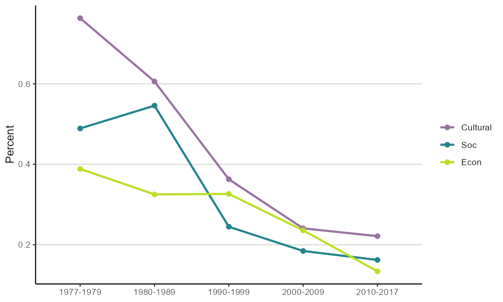
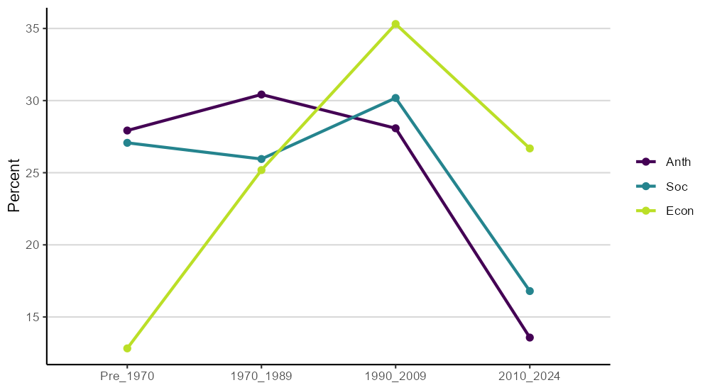
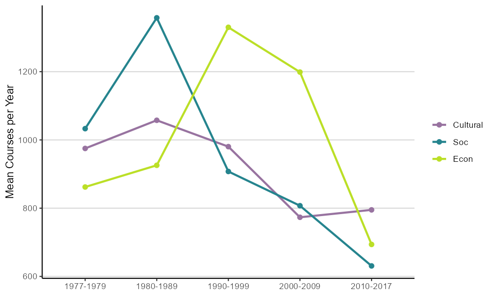

Data imported from Kortes (2026, working paper). NLP and text mining within-discipline statistics from "Repository.xlsx", overall counts and tabular legacy statistics from "Ergebnis_Eingehen_Sowi_VHS.xlsx" via `01_Data_Import.R`.

## Setup

```{r, message=FALSE, warning=FALSE}

packages <- c("tidyverse",
              "readxl",
              "ggplot2",
              "viridis",
              "ragg",
              "knitr",
              "ggpubr",
              "zoo")

pacman::p_load(packages, character.only = T)

# --- Data Import ---
df_between <- readRDS("files/df_between.RDS") %>%
  subset(Year > 1956) %>%
  mutate(Year = as.numeric(Year)) %>%
  subset(!is.na(Year))

df_between <- df_between %>%
  arrange(discipline, measure, Year) %>%
  group_by(discipline, measure) %>%
  mutate(value_roll = zoo::rollmean(value, k = 4, fill = NA, align = "center")) %>%
  ungroup()

df_fig3 <- readRDS("files/df_fig3.RDS")
df_part <- readRDS("files/df_part.RDS")
df_enroll <- readRDS("files/df_enroll.RDS")

# --- Universal Color Palette ---
# Extract the exact 3 colors from Viridis (Purple, Teal, Greenish-Yellow)
base_pal <- viridis::viridis(3, end = 0.9)

# Base R function to lighten a color by mixing it with white
lighten_color <- function(color, amount = 0.45) {
  rgb_val <- col2rgb(color)
  rgb_val <- rgb_val + (255 - rgb_val) * amount
  rgb(rgb_val[1], rgb_val[2], rgb_val[3], maxColorValue = 255)
}

# Assign the colors
c_anthro <- base_pal[1]
c_soc    <- base_pal[2]
c_econ   <- base_pal[3]
c_cult   <- lighten_color(c_anthro, 0.45) # 45% lighter than Anthropology

# Create a named vector covering all naming variations in your dataframes
disc_colors <- c(
  "Anthropology" = c_anthro,
  "Anth"         = c_anthro,
  "Cultural"     = c_cult,
  "Sociology"    = c_soc,
  "Soc"          = c_soc,
  "Economics"    = c_econ,
  "Econ"         = c_econ
)


```

## Total Discipline Trends

### Fig 1. Time Trends

```{r}

agg_png("results/Fig1.png", res = 144, height = 1000, width = 1100)

Fig1a <- ggplot(df_between %>% filter(measure == "Program results"),
                aes(x = Year, color = discipline,
                    group = interaction(discipline, measure))) +
  geom_line(aes(y = value), linewidth = 0.5, linetype = "dotted", alpha = 0.4) +
  geom_line(aes(y = value_roll), linewidth = 1.1, linetype = "solid") +
  scale_color_manual(values = disc_colors) +
  scale_x_continuous(breaks = scales::breaks_width(5)) +
  labs(x = NULL, y = "Program Catalog Rate", color = NULL) +
  theme_classic() +
  theme(
    panel.grid.major.y = element_line(),
    panel.grid.minor.y = element_line()
  )

Fig1b <- ggplot(df_between %>% filter(measure == "Page results"),
                aes(x = Year, color = discipline,
                    group = interaction(discipline, measure))) +
  geom_line(aes(y = value), linewidth = 0.5, linetype = "dotted", alpha = 0.4) +
  geom_line(aes(y = value_roll), linewidth = 1.1, linetype = "solid") +
  scale_color_manual(values = disc_colors) +
  scale_x_continuous(breaks = scales::breaks_width(5)) +
  labs(x = NULL, y = "Page Rate", color = NULL) +
  theme_classic() +
  theme(
    panel.grid.major.y = element_line(),
    panel.grid.minor.y = element_line()
  )

ggarrange(
  Fig1a, Fig1b,
  ncol = 1,
  common.legend = TRUE,
  legend = "bottom"
)

dev.off()
include_graphics("results/Fig1.png")

```


### Fig 2. Participation

#### Build

```{r}

fig2_plot <- df_part %>%
  as.data.frame() %>%
  mutate(period = rownames(.)) %>%             
  pivot_longer(
    cols = c("Cultural","Soc","Econ"),              
    names_to = "discipline",
    values_to = "value"
  ) %>%
  mutate(
    period = factor(period, levels = c("1977-1979","1980-1989","1990-1999","2000-2009","2010-2017")),
    discipline = factor(discipline, levels = c("Cultural","Soc","Econ"))
  )


```

#### Plot

```{r}

agg_png("results/Fig2.png", res = 144, height = 600, width = 1000)

ggplot(fig2_plot,
       aes(x = period, y = value,
           color = discipline,
           group = discipline)) +
  geom_line(linewidth = 1) +
  geom_point(size = 2) +
  scale_color_manual(values = disc_colors) +
  labs(x = NULL, y = "Percent", color = NULL, linetype = NULL) +
  theme_classic() +
  theme(
    panel.grid.major.y = element_line(color = "grey85"),
    panel.grid.major.x = element_blank()
  )

dev.off()


```
## Within Discipline Trends

### Fig 3. Within Time Trends


```{r}

agg_png("results/Fig3.png", res = 144, height = 550, width = 1000)

ggplot(df_fig3,
       aes(x = period, y = value,
           color = discipline,
           group = interaction(discipline, measure))) +
  geom_line(linewidth = 1) +
  geom_point(size = 2) +
  scale_color_manual(values = disc_colors) +
  scale_y_continuous(breaks = seq(0, 100, by = 5)) +
  labs(
    x = NULL,
    y = "Percent",
    color = NULL,
    linetype = NULL
  ) +
  theme_classic() +
  theme(
    panel.grid.major.y = element_line(color = "grey85"),
    panel.grid.major.x = element_blank()
  )

dev.off()




```

### Fig 4. Absolute Means

#### Build

```{r}

fig4_plot <- df_enroll %>%
  as.data.frame() %>%
  mutate(period = rownames(.)) %>%             
  pivot_longer(
    cols = c("Cultural","Soc","Econ"),              
    names_to = "discipline",
    values_to = "value"
  ) %>%
  mutate(
    period = factor(period, levels = c("1977-1979","1980-1989","1990-1999","2000-2009","2010-2017")),
    discipline = factor(discipline, levels = c("Cultural","Soc","Econ"))
  )


```

#### Plot

```{r}

agg_png("results/Fig4.png", res = 144, height = 600, width = 1000)

ggplot(fig4_plot,
       aes(x = period, y = value,
           color = discipline,
           group = discipline)) +
  geom_line(linewidth = 1) +
  geom_point(size = 2) +
  scale_color_manual(values = disc_colors) +
  labs(
    x = NULL,
    y = "Mean Courses per Year",
    color = NULL,
    linetype = NULL
  ) +
  theme_classic() +
  theme(
    panel.grid.major.y = element_line(color = "grey85"),
    panel.grid.major.x = element_blank()
  )

dev.off()



```


## References

```{r}

```

