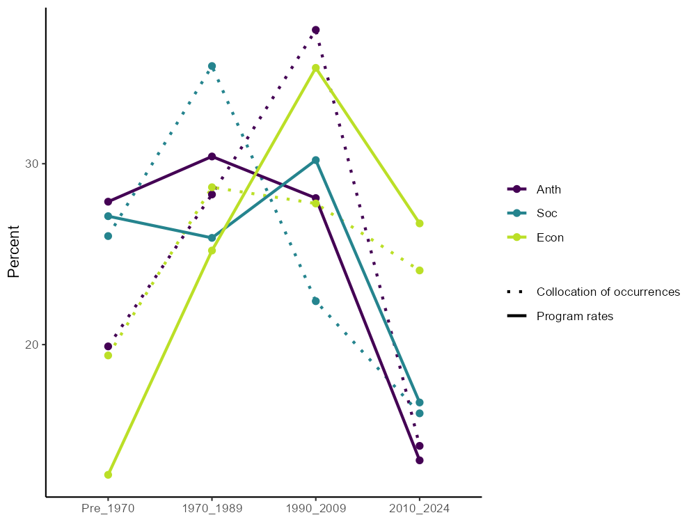

Data imported from Kortes (2026, working paper) "Ergebnis_Eingehen_Sowi_VHS.xlsx" in 01_Data_Import.R

NLP and text minning from the VHS-Archiv at the German Institute for Adult Education (DIE) produced the results for df_anthro, df_soc and df_econ

Simple tabulation of rates from the VHS-Statistik at the DIE produced results for df_part

## Setup

```{r}
packages <- c("tidyverse",
              "readxl",
              "ggplot2",
              "viridis",
              "ragg",
              "knitr")

pacman::p_load(packages, character.only = T)

df_anthro <- readRDS("files/df_anthro.RDS")
df_soc <- readRDS("files/df_soc.RDS")
df_econ <- readRDS("files/df_econ.RDS")
df_part <- readRDS("files/df_part.RDS")

```

## Fig 1. Time Trends

### Build DF

```{r}

fig1 <- as.data.frame(matrix(nrow = 3, ncol = 4))

rownames(fig1) <- c("Anth", "Soc", "Econ")
colnames(fig1) <- c("Pre_1970", "1970_1989", "1990_2009", "2010_2024")

fig1_num_prog_pct <- fig1
fig1_coloc_pct <- fig1

fig1_num_prog_pct[1,] <- round(100 * as.numeric(df_anthro[3, c(2,4,6,8)]), 1)
fig1_num_prog_pct[2,] <- round(100 * as.numeric(df_soc[3, c(2,4,6,8)]), 1)
fig1_num_prog_pct[3,] <- round(100 * as.numeric(df_econ[3, c(2,4,6,8)]), 1)

fig1_coloc_pct[1,] <- round(100 * as.numeric(df_anthro[7, c(2,4,6,8)]), 1)
fig1_coloc_pct[2,] <- round(100 * as.numeric(df_soc[7, c(2,4,6,8)]), 1)
fig1_coloc_pct[3,] <- round(100 * as.numeric(df_econ[7, c(2,4,6,8)]), 1)

fig1_plot <- bind_rows(
  fig1_num_prog_pct %>%
    as.data.frame() %>%
    mutate(discipline = rownames(.), measure = "Program rates"),
  fig1_coloc_pct %>%
    as.data.frame() %>%
    mutate(discipline = rownames(.), measure = "Collocation of occurrences")
) %>%
  pivot_longer(
    cols = c("Pre_1970","1970_1989","1990_2009","2010_2024"),
    names_to = "period",
    values_to = "value"
  ) %>%
  mutate(
    period = factor(period,
      levels = c("Pre_1970","1970_1989","1990_2009","2010_2024")),
    discipline = factor(discipline, levels = c("Anth","Soc","Econ"))
  )

```

### Plot

```{r}

agg_png("results/Fig1.png", res = 144, height = 750, width = 1000)

ggplot(fig1_plot,
       aes(x = period, y = value,
           color = discipline,
           linetype = measure,
           group = interaction(discipline, measure))) +
  geom_line(linewidth = 1) +
  geom_point(size = 2) +
  scale_color_viridis_d(option = "viridis", end = 0.9) +
  scale_linetype_manual(values = c(
    "Program rates" = "solid",
    "Collocation of occurrences" = "dotted"
  )) +
  labs(
    x = NULL,
    y = "Percent",
    color = NULL,
    linetype = NULL
  ) +
  theme_classic()

dev.off()




```

## Fig 2. Participation

```{r}

fig2_plot <- df_part %>%
  as.data.frame() %>%
  mutate(period = rownames(.)) %>%             
  pivot_longer(
    cols = c("Cultural","Soc","Econ"),              
    names_to = "discipline",
    values_to = "value"
  ) %>%
  mutate(
    period = factor(period, levels = c("1977-1979","1980-1989","1990-1999","2000-2009","2010-2017")),
    discipline = factor(discipline, levels = c("Cultural","Soc","Econ"))
  )

```

### Plot

```{r}

agg_png("results/Fig2.png", res = 144, height = 750, width = 1000)

ggplot(fig2_plot,
       aes(x = period, y = value,
           color = discipline,
           group = discipline)) +
  geom_line(linewidth = 1) +
  geom_point(size = 2) +
  scale_color_viridis_d(option = "viridis", end = 0.9) +
  labs(
    x = NULL,
    y = "Percent",
    color = NULL,
    linetype = NULL
  ) +
  theme_classic()

dev.off()

include_graphics("results/Fig2.png")

```


## Fig 3. Embeddedness

Defined as the average percentage for the period for programs, pages, total occurrences, sum of dependencies and sum of collocations plus 4 times the attendance (2 for each type.

### Build DF

```{r}

fig3_p <- fig1

fig3_p[1,] <- c(NA, 100*mean(c(df_anthro[3:7,4], rep(mean(df_part[1:2,1]/100), 4))), 100*mean(c(df_anthro[3:7,6], rep(mean(df_part[3:4,1]/100), 4))), 100*mean(c(df_anthro[3:7,8], rep(df_part[5,1]/100, 4))))

fig3_p[2,] <- c(NA, 100*mean(c(df_soc[3:7,4], rep(mean(df_part[1:2,2]/100), 4))), 100*mean(c(df_soc[3:7,6], rep(mean(df_part[3:4,2]/100), 4))), 100*mean(c(df_soc[3:7,8], rep(df_part[5,2]/100, 4))))

fig3_p[3,] <- c(NA, 100*mean(c(df_econ[3:7,4], rep(mean(df_part[1:2,3]/100), 4))), 100*mean(c(df_econ[3:7,6], rep(mean(df_part[3:4,3]/100), 4))), 100*mean(c(df_econ[3:7,8], rep(df_part[5,3]/100, 4))))

fig3_pt <- (fig3_p - 9)*90/max(fig3_p-9, na.rm = T)

fig3_pt <- select(fig3_pt, -Pre_1970)

fig3_plot <- fig3_pt %>%
  as.data.frame() %>%
  mutate(discipline = rownames(.)) %>%
  pivot_longer(
    cols = c("1970_1989","1990_2009","2010_2024"),
    names_to = "period",
    values_to = "value"
  ) %>%
  mutate(
    period = factor(period, levels = c("1970_1989","1990_2009","2010_2024")),
    discipline = factor(discipline, levels = c("Anth","Soc","Econ"))
  )

```

### Plot

```{r}

agg_png("results/Fig3.png", res = 144, height = 750, width = 1000)

ggplot(fig3_plot,
       aes(x = period, y = value,
           color = discipline,
           group = discipline)) +
  geom_line(linewidth = 1) +
  geom_point(size = 2) +
  scale_color_viridis_d(option = "viridis", end = 0.9) +
  labs(
    x = NULL,
    y = "Score",
    caption = "Embededness score is a realtivized average of the period\npercentage for the discipline hits for programs, pages,\ntotal occurrences, sum of dependencies and sum\nof collocations, plus the attendance weighted by a factor of 4.",
    color = NULL,
    linetype = NULL,
    title = "Embededness of Disciplines in Adult Learning"
  ) +
  theme_classic()

dev.off()

include_graphics("results/Fig3.png")

```


## References

```{r}

```

